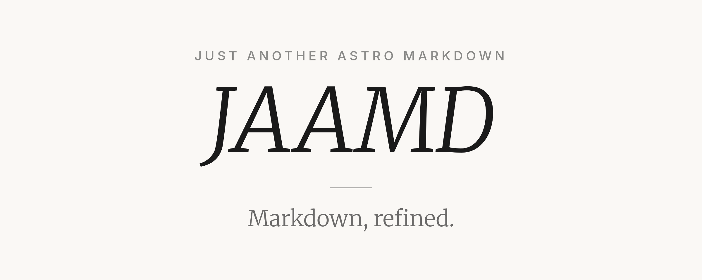

<p align="center">
  <a href="https://docs.jaamd.org/jaamd">
    
  </a>
</p>

<p align="center">
  Markdown plugins, client-side enhancements and styles as a single <a href="https://astro.build">Astro</a> integration.
</p>

---

Alerts, code tabs, a table of contents and spoilers in your markdown; heading
anchors, scrollable tables, copy buttons and an image lightbox on the page; a
stylesheet driven by CSS variables, with eight theme presets.

## Installation

```bash
npx astro add @jaamd/astro
```

Or install it and register it yourself:

```ts
// astro.config.mjs
import jaamd from '@jaamd/astro'
import { defineConfig } from 'astro/config'

export default defineConfig({
    integrations: [jaamd()],
})
```

Then wrap your markdown in the component, in your layout:

```astro
---
import MarkdownContent from '@jaamd/astro/components'
---

<MarkdownContent>
    <slot />
</MarkdownContent>
```

Requires Astro `^7.3.0` and Node `>=22.23.4`.

## Documentation

The documentation ships with the package, in
[`docs/`](https://github.com/jaamd/jaamd/tree/main/packages/astro/docs): once
installed, at `node_modules/@jaamd/astro/docs/`. Point an agent's `AGENTS.md`
there. It is also published at [docs.jaamd.org](https://docs.jaamd.org).

| Page                                                          | What                                                          |
| ------------------------------------------------------------- | ------------------------------------------------------------- |
| [Installation](./docs/01-getting-started/01-installation.md)  | Requirements and setup                                        |
| [Options](./docs/05-configuration/01-options.md)              | `theme`, `selector`, `defaultVariables`, `features`, `labels` |
| [Markdown syntax](./docs/02-markdown.md)                      | Alerts, code tabs, table of contents, spoilers                |
| [MarkdownContent](./docs/03-usage/01-markdown-content.md)     | The wrapper component                                         |
| [Client script](./docs/03-usage/02-client.md)                 | Enhancements, keyboard, lightbox                              |
| [Variables](./docs/04-styling/01-variables.md)                | CSS variables, font sizes, dark mode                          |
| [Themes](./docs/04-styling/02-themes.md)                      | Presets and dual-theme Shiki                                  |
| [Markup and classes](./docs/04-styling/03-markup.md)          | The emitted HTML                                              |
| [Manual setup](./docs/06-advanced/01-manual-setup.md)         | Registering the plugins yourself                              |
| [Frontmatter fields](./docs/06-advanced/02-frontmatter.md)    | `frontmatterFields(z)`                                        |
| [Other frameworks](./docs/06-advanced/03-other-frameworks.md) | `@jaamd/core`                                                 |
| [Upgrading](./docs/07-upgrading.md)                           | Changes between versions                                      |
