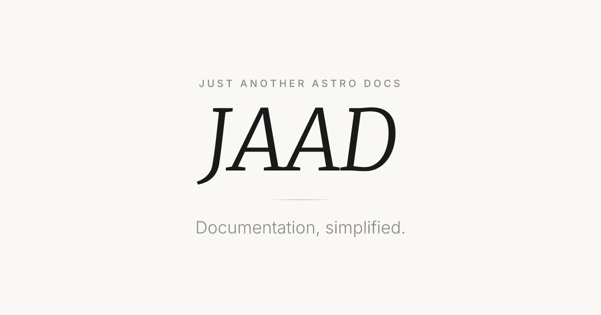

JAAB is a blog for Astro, on the same shell as JAAD.

<!-- more -->

It reads a folder of Markdown and writes the index, the feed and the sitemap.



## Three ways in

### A blog on its own

Add the integration and a folder of posts.

```js
import jaab from '@jaamd/jaab'
```

## What a post needs

A title and a date.
