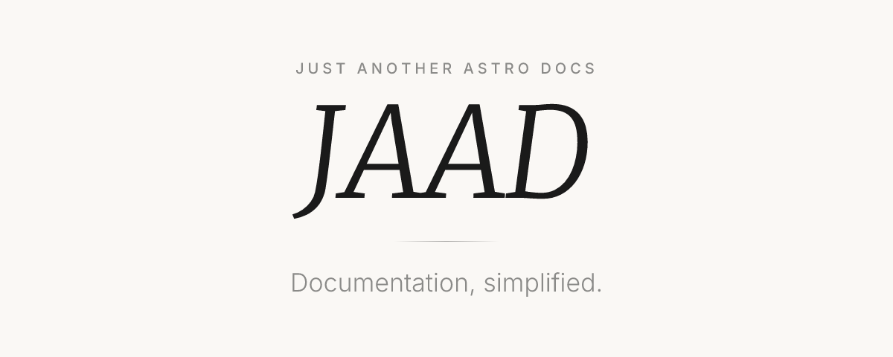

<p align="center">
  <a href="https://jaamd.org/docs/jaad">
    
  </a>
</p>

<p align="center">
  An <a href="https://astro.build">Astro</a> integration that turns a folder of markdown into a documentation site.
</p>

<div align="center">

[](https://github.com/jaamd/jaamd/actions/workflows/ci.yml)
[](https://github.com/withastro/astro/blob/main/LICENSE)
[](https://badge.fury.io/js/@jaamd%2Fjaad)
</div>

```bash
npm create @jaamd/jaad@latest my-docs
```

Or add it to a repository that already has a `docs/` folder:

```bash
npm create @jaamd/jaad@latest -- --here
```

By hand:

```bash
npm install @jaamd/jaad
```

```ts
// jaad.config.ts
import { defineJaadConfig } from '@jaamd/jaad'

export default defineJaadConfig({
    site: 'https://example.dev',
    title: 'My Project',
})
```

Documentation: [jaamd.org/docs/jaad](https://jaamd.org/docs/jaad)

## Contributing

See [CONTRIBUTING.md](./CONTRIBUTING.md), including the guide for contributing
new interface translations.

## License

jaad is released under the [MIT License](/LICENSE).
